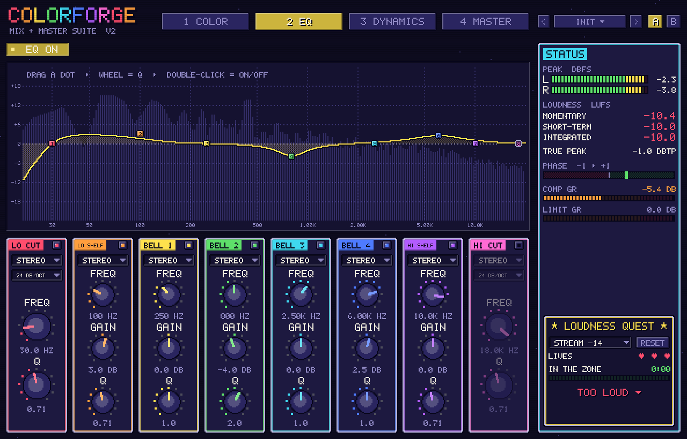

# ColorForge

A mixing & mastering suite for Windows with an 8-bit look: a **VST3 plugin** and a **standalone player** that loops any audio file you drop on it through the chain. It started as a color-bass multi-effect, and that chain is still inside as the COLOR module.



More pages: [MOD](docs/screenshot-mod.png) · [MASTER](docs/screenshot-master.png) · [DYNAMICS](docs/screenshot-dynamics.png) · [COLOR](docs/screenshot-color.png)

## Signal chain

`Input → Color FX → [EQ · Compressor · Saturator · Stereo, in any order] → Output → Limiter → Meters`

Every module has its own bypass, and every control is a host parameter, so all of it can be automated in a DAW. The editor has five pages (COLOR, EQ, DYNAMICS, MASTER, MOD) and an always-visible STATUS column.

| Module | What it does |
| --- | --- |
| **EQ** | 8 bands: low cut and high cut (12 / 24 / 36 / 48 dB per octave), low and high shelf, four bells. Each band works on stereo, mid only or side only. The shelves and bells can be dynamic (DYN): the gain only kicks in when that band gets louder than its threshold (THR), reaching the full amount 12 dB above it, and a dotted trace shows what is applied right now. Drag the numbered dots on the graph (wheel = Q, double-click = on/off) over the live spectrum. |
| **Compressor** | Stereo-linked bus compressor: threshold, ratio, attack, release, soft knee, makeup or auto gain, parallel mix, sidechain high-pass. Transfer curve and gain-reduction history. |
| **Saturator** | Tape, tube and clip curves with drive, tilt tone, mix and output; the level is kept roughly constant as you drive it. |
| **Stereo** | Mid/side width, mono bass below a chosen frequency, balance. |
| **Limiter** | Lookahead brickwall limiter with 4x true-peak detection: gain, ceiling (dBTP), release. `Clip` mode is the soft clipper from v1. About 1.6 ms of latency. |
| **Meters** | Sample peak, LUFS momentary / short-term / integrated (BS.1770 / EBU R128 gating), true peak, phase correlation, compressor and limiter gain reduction, and a 60-second loudness map. |
| **Presets** | Factory starting points (mix bus glue, streaming and club masters, vocal, drums, tape, wide + mono bass, the v1 color-bass sound) from the bar at the top right, plus your own presets saved as `.cfpreset` files in `Documents/ColorForge/Presets`. Hosts see the factory presets as programs. |
| **Level-matched bypass** | BYPASS in the STATUS column plays the dry input, delayed to line up and raised or lowered to the processed loudness, so you hear what the processing does rather than "louder". |
| **A/B** | Two snapshots for comparing settings; the preset menu copies one into the other. Kept for the session, not saved with the project. |
| **Chain order** | Drag EQ, COMP, SAT and STEREO around on the DYNAMICS page's signal-path map. The order is saved with the session and in presets. |
| **Modulation** | MOD page: two LFOs (sine, triangle, saws, square, random; free in Hz or synced to the host tempo from 4 bars to 1/16), an envelope follower on the input, and four macro knobs. An 8-slot matrix routes any of them to 38 targets (EQ gains and frequencies, compressor, saturator, width, limiter gain, levels and the color FX). Knobs show a white pip where modulation is taking them; the knob itself (and its automation) stays where you set it. |
| **Loudness quest** | Pick a target (club, loud, streaming -14, podcast, broadcast). Keep the short-term loudness within 1 LU of it for 30 seconds without overshooting the ceiling to clear the stage. |

### Color FX (the original ColorForge chain)

Off by default in v2; switch on **COLOR FX** on the COLOR page.

`Drive → [Resonator · Freq Shift · Pitch Map, in any order] → Chorus → Reverb → OTT → Width`

Color bass turns a plain bass sound into something that plays chords: every harmonic gets pulled onto the notes of a scale or chord, then smeared, widened and squashed.

The sub (below a cutoff you choose) can bypass the whole chain so the low end stays clean and mono-safe.

| Stage | What it does |
| --- | --- |
| **Pitch Map** | Phase-vocoder remapping: each spectral partial is moved to the nearest allowed note. Amount, purity (cuts energy far from the notes), ±24 st shift, spectral smear. |
| **Resonator** | Up to 24 tuned voices on the chord tones, stacked over 1–4 octaves. Modes: `Comb +`, `Comb -` (hollow, odd harmonics), `Tone` (sine-like ringing). Decay, damping, stereo detune. |
| **Freq Shift** | Single-sideband shifter, ±2000 Hz, with stereo spread, feedback and an LFO. |
| **Chorus / Reverb** | Widening and wash; the reverb has a freeze switch. |
| **OTT** | 3-band upward + downward compression with depth, time and per-band gain, movable crossovers (X LOW, X HIGH) and a solo for each band. |
| **Notes** | Root, 15 scales, 17 chords, or **MIDI Follow**: the notes you hold define the note set. |

The analyzer colours every frequency by its pitch class, so you can see which notes the sound is made of. The pitch map adds about 85 ms of latency, but only while COLOR FX and the pitch map are both on.

## Download

Grab the files from the [latest release](../../releases/latest):

- `ColorForge-Player-win64.exe`: the standalone player. No install; just run it. It is unsigned, so Windows SmartScreen may ask for confirmation (*More info → Run anyway*).
- `ColorForge-VST3-win64.zip`: unzip and copy the `ColorForge.vst3` folder to `C:\Program Files\Common Files\VST3\`, then rescan plugins in your DAW.

## Using the player

- Drop an audio file anywhere on the window (WAV, AIFF, FLAC, OGG, MP3). It starts looping through the plugin.
- `Space` plays / stops. Click or drag on the waveform to seek.
- **Export WAV** renders the loaded file with the current settings, and its automation lanes, to a 24-bit WAV.
- **Automation lanes:** arm **REC**, press play and move any control. Each control you touch is written to its own lane while you hold it (touch mode), across as many loops as you like, and plays back while **READ** is on. Pick a lane under the waveform to see it; drag on it to draw, double-click to clear. **Lanes...** saves them next to the audio file as `<name>.cfauto` (loaded again automatically with the file) or anywhere else.
- Turn on **MIDI Follow** and play the on-screen keyboard (or a MIDI keyboard enabled under *Audio Settings*) to set the chord by hand.
- Headless render with default settings: `ColorForge-Player-win64.exe --render input.wav output.wav [lanes.cfauto]`

## Building

Requirements on `PATH`: Git, CMake 3.22+, Ninja and MinGW-w64 GCC (for example [WinLibs](https://winlibs.com/)).

```bat
make.bat
```

The script fetches JUCE 7.0.12 into `JUCE7/`, then builds both targets into `build-mingw/`:

- `build-mingw/ColorForge_artefacts/Release/VST3/ColorForge.vst3`
- `build-mingw/ColorForgePlayer_artefacts/Release/ColorForge Player.exe`

JUCE 7 is used because JUCE 8 no longer supports MinGW.

To cross-compile from Linux with the `mingw-w64` packages, configure with `-DCMAKE_TOOLCHAIN_FILE=cmake/mingw-w64-x86_64.cmake` (see `.github/workflows/build.yml`).

Offline DSP checks live in `Tests/DspTests.cpp`: build the `ColorForgeTests` target and run it (it exits non-zero on failure). `ColorForgeTests --snapshot <dir>` renders each editor page to a PNG. The code has only been built with this toolchain (GCC 16.2, JUCE 7.0.12).

## Status

Early release. Checked so far: offline renders land on the selected chord tones, the VST3 module loads and exposes its classes, and the standalone player plays and exports. It has **not yet been tested inside a DAW**, and the default settings have not been tuned by ear.

## License

ColorForge is released under the [GNU General Public License v3.0](LICENSE). It is built on [JUCE](https://juce.com/), used here under its GPLv3 option.

The frequency shifter uses Olli Niemitalo's allpass Hilbert-transformer coefficients.
